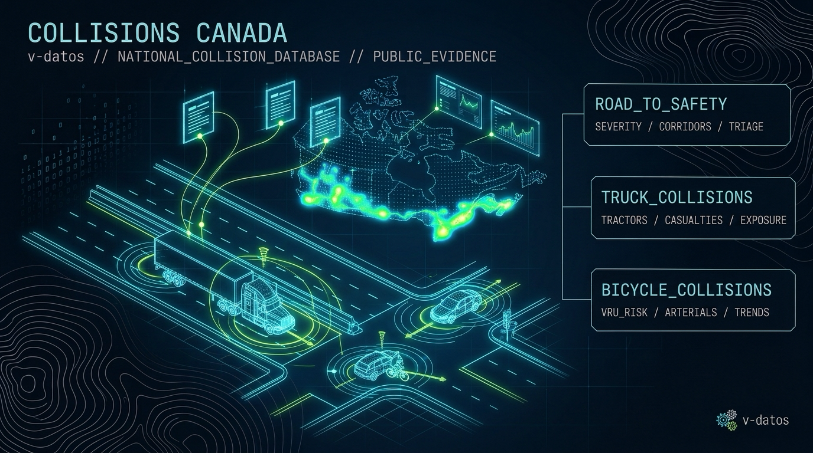

# Canadian Traffic Collision Research



This repository brings together empirical research, statistical modeling, and interactive reporting on **road safety and traffic collisions in Canada (1999–2024)**. Using public collision microdata and aggregate statistics from **Transport Canada** and **Statistics Canada**, the research is organized into three independent studies examining all-road-user collision severity, vulnerable road users (bicyclists), and commercial heavy freight (road tractors).

---

## Final Products & Deliverables

The primary reports, policy briefs, and interactive applications produced across the repository are available directly below.

### 1. Executive Policy Brief (PDF) & Portfolio Bundle
* **[Road to Safety — Policy Brief (PDF)](projects/road_to_safety/reports/portfolio/road-to-safety-policy-brief.pdf)**: A 6-page executive brief summarizing national casualty trends (2005–2024), 2024 provincial and territorial casualty rates, predictive severity modeling results, and evidence-backed road safety recommendations.
* **[Road to Safety — Complete Portfolio Bundle (ZIP)](projects/road_to_safety/reports/portfolio/road-to-safety-portfolio.zip)**: Downloadable archive packaging the PDF policy brief together with the standalone interactive web reports.

### 2. Interactive Websites & Standalone Web Reports (HTML)
* **[Commercial Road-Tractor Collisions (1999–2021) — Interactive Data App (Live Web App)](https://v-datos.github.io/road_to_safety/projects/trucks/reports/index.html)** · *([Repo HTML](projects/trucks/reports/index.html))*: A standalone, single-file interactive freight analytics app exploring 80,540 road-tractor casualty collisions, victim asymmetry (71.7% other-vehicle fatalities), configuration decomposition (+0.835 pp fatal share change), Table 10 freight VKT sensitivity (−44.5% rate decline), and vehicle-age severity cohorts.
* **[Road to Safety — Public Interactive Story (Live Web App)](https://v-datos.github.io/road_to_safety/projects/road_to_safety/reports/portfolio/index.html)** · *([Repo HTML](projects/road_to_safety/reports/portfolio/index.html))*: A visual story and interactive dashboard featuring national collision trends, temporal and environmental risk profiles, and an interactive 2024 map of casualty rates across all 13 Canadian provinces and territories.
* **[Road to Safety — Full Technical Report (Live Web App)](https://v-datos.github.io/road_to_safety/projects/road_to_safety/reports/portfolio/technical-report.html)** · *([Repo HTML](projects/road_to_safety/reports/portfolio/technical-report.html))*: A self-contained interactive technical report detailing exploratory data analysis, predictive model comparisons (Logistic Regression, Random Forest, LightGBM), calibration transfer stress tests, and subgroup analyses.
* **[Canadian Bicycle Collisions (2010–2023) — Interactive Data App (Live Web App)](https://v-datos.github.io/road_to_safety/projects/bicycles/reports/canada-bicycle-collisions-2010-2023.html)** · *([Repo HTML](projects/bicycles/reports/canada-bicycle-collisions-2010-2023.html))*: A portable, single-file interactive web application exploring national bicycle collision trends, the 2023 post-pandemic rebound, seasonal and intersection patterns, and heavy-vehicle co-involvement lethality.
* **[Road to Safety — Stakeholder Evidence Report (Live Web App)](https://v-datos.github.io/road_to_safety/projects/road_to_safety/reports/data_gap_2026_11_04/stakeholder_report/dist/index.html)** · *([Repo HTML](projects/road_to_safety/reports/data_gap_2026_11_04/stakeholder_report/dist/index.html))*: An interactive data application summarizing what operational and policy decisions the public evidence supports and where public data gaps remain.

> **Viewing Tip:** Click any **Live Web App** link above to open the interactive report directly in your browser via GitHub Pages, or open the standalone `.html` files locally from a clone / [portfolio ZIP](projects/road_to_safety/reports/portfolio/road-to-safety-portfolio.zip). Markdown (`.md`) and PDF (`.pdf`) deliverables also render directly on GitHub.

---

## Research Projects & Written Findings

Each project under [`projects/`](projects/README.md) is self-contained with its own data pipeline, validation suite, executed Jupyter notebooks, and written reports.

### 1. [Road to Safety: All-Road-User Severity, Corridors & Triage](projects/road_to_safety/README.md)
Investigates collision severity across **2.95 million candidate collisions (1999–2021)** and national aggregate trends (**2005–2024**), evaluating machine learning severity models, urban corridor exposure screening, and operational triage rules.
* **Key Findings & Written Reports**:
  * **[Exploratory & Descriptive Analysis](projects/road_to_safety/docs/descriptive_analysis.md)**: Long-term casualty trends, time-of-day/seasonal patterns, and weather, surface, and road configuration risk profiles.
  * **[Operational Action Plan Results](projects/road_to_safety/docs/operational_action_plan_results.md)**: Synthesis of four applied studies:
    1. *Toronto Corridor Exposure Pilot* (Empirical Bayes / Negative Binomial Safety Performance Functions across 1,546 road corridors).
    2. *Road-User & Vehicle Typology Severity Models* (quantifying vulnerability across pedestrians, bicyclists, motorcyclists, and heavy trucks).
    3. *3-Tier Operational Triage* (cost-utility decision thresholds and intake vs. post-collision information value).
    4. *Prospective Drift Monitoring* (PSI and calibration tracking for post-2021 releases).
  * **[Severity Modeling Baseline](projects/road_to_safety/docs/severity_modeling.md)**, **[Temporal Calibration Study](projects/road_to_safety/docs/temporal_calibration_v1_results.md)** & **[Calibration Stress Test](projects/road_to_safety/docs/calibration_stress_v1_results.md)**: Chronological evaluation of predictive models and post-hoc probability calibration.
  * **[Policy Evidence Synthesis](projects/road_to_safety/docs/policy_evidence.md)** & **[Data Quality Assessment](projects/road_to_safety/docs/data_quality_assessment.md)**.
* **Notebooks & Evidence Catalog**:
  * **[Executed Notebooks Index (9 notebooks)](projects/road_to_safety/notebooks/README.md)**
  * **[Report Tables, Figures & Portfolio Index](projects/road_to_safety/reports/README.md)**

---

### 2. [Canadian Bicycle Collisions (2010–2023)](projects/bicycles/README.md)
Examines national bicycle-involved collisions, bicyclist casualties (**712 deaths and 75,610 non-fatal injuries** recorded across 2010–2023), co-involved vehicle lethality, and urban corridor exposure.
* **Key Highlights**:
  * Recorded bicycle involvements fell **27.0%** from 2010 to 2023 overall, but rebounded **+21.1%** in 2023 compared to 2022 (exceeding 2019 pre-pandemic levels by 5.9%).
  * Heavy unit trucks and road tractors are co-involved in only **2.05%** of linked bicycle casualty collisions (2010–2021) but account for **20.36%** of fatal bicycle collisions (**10.8×** and **18.9×** higher fatality share than light-duty vehicles).
  * Linking national severity models with Toronto corridor vehicle-kilometres travelled (VKT) shows that Major and Minor Arterials concentrate **82.3%** of monitored cyclist KSI (killed or seriously injured) crashes.
* **Key Findings & Written Reports**:
  * **[Corridor Exposure & Heavy-Vehicle Lethality Synthesis](projects/bicycles/docs/corridor_exposure_synthesis.md)**
  * **[Dataset Validation & Benchmark Reconciliation](projects/bicycles/docs/validation.md)**
  * **[Data Contract & Definitions](projects/bicycles/docs/data_contract.md)**
* **Notebooks & Evidence Catalog**:
  * **[Executed Notebooks Index (3 notebooks)](projects/bicycles/notebooks/README.md)**
  * **[Report Outputs, Figures & Portable HTML Guide](projects/bicycles/reports/README.md)**

---

### 3. [Commercial Truck Collisions (1999–2021)](projects/trucks/README.md)
Analyzes collisions involving commercial road tractors (semi-trucks) across Canada over two decades, examining event frequency, casualty distribution, environmental conditions, collision configurations, VKT exposure sensitivity, and tractor age.
* **Interactive Deliverable**:
  * **[Truck Collision Interactive Data App (Live Web App)](https://v-datos.github.io/road_to_safety/projects/trucks/reports/index.html)** · *([Repo HTML](projects/trucks/reports/index.html))*: Interactive telemetry dashboard, victim breakdown (71.7% other-vehicle fatalities), configuration decomposition, Table 10 VKT exposure sensitivity, and vehicle-age audit.
* **Key Findings & Written Reports**:
  * **[Project Status & Executive Summary](projects/trucks/docs/project_status.md)**: Overview of all research questions, completed analyses, and key takeaways.
  * **[Descriptive Trend Findings (1999–2021)](projects/trucks/reports/trends/findings.md)**: Long-term trajectory of road-tractor collisions and fatal collision share compared against non-tractor benchmarks.
  * **[Casualty Findings — Who is Harmed?](projects/trucks/reports/casualties/findings.md)**: Breakdown of fatalities and injuries between tractor occupants and other road users sharing the road.
  * **[Weather, Surface & Road Condition Findings](projects/trucks/reports/conditions/findings.md)**: Comparison of environmental and road settings between tractor-involved and non-tractor collisions.
  * **[Configuration Decomposition](projects/trucks/reports/decomposition/findings.md)**: Separating changes in fatal collision rates into shifts in collision configuration mix versus within-configuration severity.
  * **[VKT Exposure Sensitivity (2015–2021)](projects/trucks/docs/model_normalized_vkt_sensitivity.md)**: Normalizing collision trends against Transport Canada Table 10 heavy-truck vehicle-kilometres travelled.
  * **[Vehicle Age (`V_YEAR`) Severity Audit](projects/trucks/docs/vehicle_age_severity.md)**: Evaluating whether older road tractors exhibit higher conditional fatality rates after controlling for speed limit, road configuration, and weather.
* **Notebooks**:
  * **[Executed Notebooks Index (9 notebooks)](projects/trucks/notebooks/README.md)**

---

## Official Data Sources

* **[Transport Canada — Road Transportation Statistics and Data](https://tc.canada.ca/en/road-transportation/statistics-data)**: Official index for Canadian Motor Vehicle Traffic Collision Statistics and commercial vehicle safety reports.
* **[National Collision Database (NCDB) Online](https://wwwapps2.tc.gc.ca/Saf-Sec-Sur/7/NCDB-BNDC/p.aspx?l=en)**: Interactive national aggregate query tool.
* **[NCDB Open Government Dataset](https://open.canada.ca/data/en/dataset/1eb9eba7-71d1-4b30-9fb1-30cbdab7e63a)**: Public collision microdata releases and data dictionaries.

---

## Reproducibility & Technical Verification

Each project manages its own Python environment via [`uv`](https://docs.astral.sh/uv/) and can be reproduced independently from its directory (see [the project organization guide](projects/README.md)).

From the repository root, you can run the full automated verification suite (120 tests across all three projects) or rebuild the portfolio deliverables:

```bash
make verify        # Run portable test suites across all three projects
make verify-full   # Run full test suites including local derived dataset assertions
make report-rts    # Rebuild Road to Safety HTML reports, PDF policy brief, and portfolio ZIP
make report-trucks # Rebuild Trucks interactive telemetry data app
```

