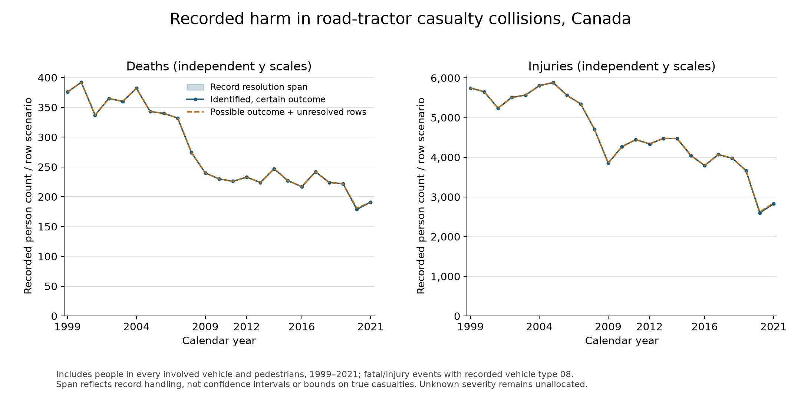
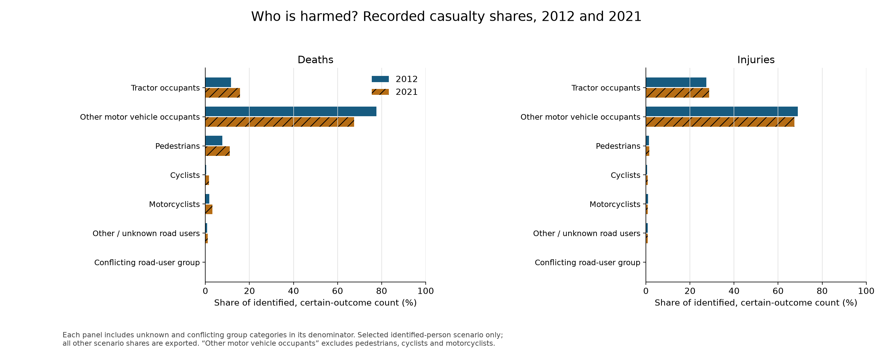
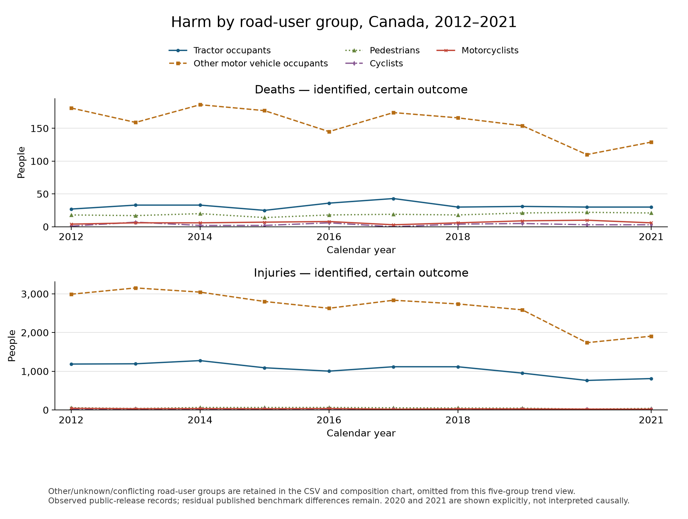

# Who is harmed in recorded road-tractor casualty collisions?

## Answer and scope

For 2012–2021, the identified-person, certain-outcome death count changed from 233 to 191 (-18.03%); injuries changed from 4,337 to 2,828 (-34.79%). The higher record scenario produces changes of -18.03% for deaths and -34.42% for injuries. These are counts reconstructed from this public release, with the unresolved identity and severity records visible below.

The target remains **2016–2025**. Available records cover **1999–2021**; 2012–2021 is the historical decade and 2016–2021 the available portion of the target. No result here establishes 2022–2025 outcomes, risk per kilometre, fault, or cause. The source-version repair substantially reduced the 2019 event benchmark discrepancy; a residual two injury-event difference remains unresolved.

Deaths per 100 recorded casualty collisions changed from 7.06 in 2012 to 8.39 in 2021 in the identified, certain-outcome scenario. Thus fewer recorded events coincided with fewer recorded deaths, but deaths declined less than events. This measure is people killed per casualty event, distinct from the fatal-event share; neither measures driving risk. The denominator excludes property-damage-only crashes. Exact annual values for both scenarios and event subsets are in `harm_per_collision.csv`.

## Counting method and what the scenarios mean

The pipeline selects whole events with recorded vehicle type 08 (road tractor with or without semitrailer), then uses records for **all people in each selected event**. Its separate contract and validation document identity resolution, raw duplicate treatment, group conflicts and dummy handling. Vehicle ID 99 is a pedestrian dummy vehicle and does not imply a dummy person. Person ID NN represents a dummy person and is excluded from harm counts; unidentified people remain unresolved records. No synthetic identity is created.

The low scenario counts identified person keys whose coded outcome is certain under the retained record variants. The high scenario counts each identified key if the outcome is possible under its variants and adds every raw unresolved-identity row coded with that outcome. The span therefore exposes alternative record handling. It is **not a confidence interval, not a lower/upper bound on actual casualties, and not an imputation**. Repeated unresolved rows might represent one person or several; missing people and unknown severity cannot be bounded by these data. Separate death and injury highs can overlap for a key with contradictory severity, so those highs must not be added to claim a unique casualty total.

P_ISEV 3 denotes a recorded fatality, 2 a recorded injury. Not-applicable severity N is counted separately from unknown/unavailable severity. Unknown/unavailable severity is never relabeled as death, injury or uninjured. Group classification uses source road-user and vehicle codes checked for consistency, retaining other/unknown and conflicting groups explicitly. Other motor vehicle occupants exclude pedestrians, cyclists and motorcyclists. Group scenario shares use the corresponding all-group scenario denominator; they are coherent scenario compositions, not bounds on true shares.

## Annual all-person results

| Year | Death record span | Injury record span | Unknown severity: identified keys | Unknown severity: unresolved rows | N severity: identified / unresolved |
| --- | --- | --- | --- | --- | --- |
| 1999 | 376–376 | 5,746–5,746 | 810 | 0 | 0 / 0 |
| 2000 | 392–392 | 5,653–5,655 | 21 | 0 | 900 / 0 |
| 2001 | 337–337 | 5,237–5,237 | 27 | 0 | 796 / 0 |
| 2002 | 365–365 | 5,508–5,509 | 29 | 0 | 897 / 0 |
| 2003 | 360–360 | 5,568–5,568 | 39 | 0 | 875 / 0 |
| 2004 | 382–382 | 5,805–5,805 | 30 | 0 | 947 / 0 |
| 2005 | 343–343 | 5,884–5,884 | 41 | 1 | 1001 / 0 |
| 2006 | 340–340 | 5,561–5,561 | 92 | 0 | 754 / 0 |
| 2007 | 332–332 | 5,345–5,345 | 94 | 0 | 773 / 0 |
| 2008 | 274–274 | 4,705–4,705 | 102 | 0 | 649 / 0 |
| 2009 | 240–240 | 3,856–3,856 | 165 | 0 | 609 / 0 |
| 2010 | 230–230 | 4,269–4,269 | 204 | 0 | 538 / 0 |
| 2011 | 226–226 | 4,444–4,446 | 300 | 0 | 635 / 0 |
| 2012 | 233–233 | 4,337–4,337 | 350 | 0 | 489 / 0 |
| 2013 | 224–224 | 4,473–4,478 | 316 | 0 | 432 / 0 |
| 2014 | 247–247 | 4,472–4,475 | 257 | 0 | 470 / 0 |
| 2015 | 227–227 | 4,046–4,047 | 259 | 16 | 413 / 1 |
| 2016 | 217–217 | 3,794–3,796 | 225 | 6 | 450 / 0 |
| 2017 | 242–242 | 4,068–4,071 | 155 | 0 | 453 / 0 |
| 2018 | 224–224 | 3,977–3,978 | 82 | 6 | 419 / 0 |
| 2019 | 222–222 | 3,665–3,666 | 82 | 6 | 534 / 0 |
| 2020 | 179–181 | 2,599–2,625 | 246 | 10 | 88 / 0 |
| 2021 | 191–191 | 2,828–2,844 | 221 | 4 | 84 / 0 |

## Who bears the recorded harm?

| Road-user group | 2012 deaths | 2021 deaths | 2012 injuries | 2021 injuries |
| --- | --- | --- | --- | --- |
| Tractor occupants | 27–27 | 30–30 | 1,187–1,187 | 812–812 |
| Other motor vehicle occupants | 181–181 | 129–129 | 2,991–2,991 | 1,907–1,922 |
| Pedestrians | 18–18 | 21–21 | 59–59 | 42–42 |
| Cyclists | 1–1 | 3–3 | 23–23 | 22–22 |
| Motorcyclists | 4–4 | 6–6 | 44–44 | 23–24 |
| Other / unknown road users | 2–2 | 2–2 | 33–33 | 22–22 |
| Conflicting road-user group | 0–0 | 0–0 | 0–0 | 0–0 |

Other motor vehicle occupants account for 1,581 of 2,206 identified, certain-outcome deaths during 2012–2021 (71.67%). This pooled share divides summed deaths by summed all-group deaths, not an average of annual percentages. All pooled group shares and both scenarios are in `pooled_group_shares.csv`.

Deaths among tractor occupants changed from 27 to 30 (+11.11%), while deaths among other motor vehicle occupants changed from 181 to 129 (-28.73%). In 2021 pedestrians, cyclists and motorcyclists together account for 30 deaths, compared with 23 in 2012. These small endpoint subgroup counts can fluctuate: they describe where recorded harm occurred and do not establish a trend in risk or an explanation for the changes.

The often quoted approximately 70% finding for other-vehicle occupants in [Transport Canada’s broader commercial-vehicle analysis](https://tc.canada.ca/en/road-transportation/statistics-data/commercial-vehicle-collisions/2021/commercial-vehicle-collisions-canada-2012-2021) is **not assumed to apply to semis**. The following values calculate this study’s other-motor-vehicle-occupant share from its own records, with all unknown/conflicting groups in the denominator. Pedestrians, cyclists and motorcyclists are displayed separately rather than being described as other-vehicle occupants.

| Year | Other vehicle death share: low scenario | Other vehicle death share: high scenario | Tractor occupant death share: low | Other/unknown/conflicting death share: low |
| --- | --- | --- | --- | --- |
| 2012 | 77.68% | 77.68% | 11.59% | 0.86% |
| 2016 | 66.82% | 66.82% | 16.59% | 1.84% |
| 2019 | 69.37% | 69.37% | 13.96% | 0.90% |
| 2020 | 61.45% | 61.88% | 16.76% | 2.23% |
| 2021 | 67.54% | 67.54% | 15.71% | 1.05% |

## Change over time and sensitivity

| Period | Deaths change: low | Deaths change: high | Injuries change: low | Injuries change: high |
| --- | --- | --- | --- | --- |
| 2012–2021 | -18.03% | -18.03% | -34.79% | -34.42% |
| 2012–2019 | -4.72% | -4.72% | -15.49% | -15.47% |
| 2016–2021 | -11.98% | -11.98% | -25.46% | -25.08% |
| 2016–2019 | +2.30% | +2.30% | -3.40% | -3.42% |
| 2019–2020 | -19.37% | -18.47% | -29.09% | -28.40% |
| 2020–2021 | +6.70% | +5.52% | +8.81% | +8.34% |
| 2019–2021 | -13.96% | -13.96% | -22.84% | -22.42% |

The 2012–2019 and 2016–2019 comparisons describe the pre-2020 endpoints; 2019–2020 and 2020–2021 show the disruption and rebound directly. These comparisons describe timing, not a causal effect. The validated 2019 XLSX replaces the earlier CSV and substantially reduces the event benchmark gap. A residual two injury-event difference remains; comparisons using 2019 retain that source/definition qualification. No casualty “correction” is inferred from a difference in collision counts. The 2012–2021 and 2016–2021 endpoint comparisons do not use 2019; the following pooled summaries also show results excluding it.

| Block | Scenario | Included years | Deaths total | Mean annual deaths | Injuries total | Mean annual injuries |
| --- | --- | --- | --- | --- | --- | --- |
| 2012–2016 | low | 5 | 1148 | 229.6 | 21122 | 4224.4 |
| 2012–2016 | high | 5 | 1148 | 229.6 | 21133 | 4226.6 |
| 2017–2021 | low | 5 | 1058 | 211.6 | 17137 | 3427.4 |
| 2017–2021 | high | 5 | 1060 | 212.0 | 17184 | 3436.8 |
| 2017–2021 excluding 2019 | low | 4 | 836 | 209.0 | 13472 | 3368.0 |
| 2017–2021 excluding 2019 | high | 4 | 838 | 209.5 | 13518 | 3379.5 |
| 2016–2021 | low | 6 | 1275 | 212.5 | 20931 | 3488.5 |
| 2016–2021 | high | 6 | 1277 | 212.8 | 20980 | 3496.7 |
| 2016–2021 excluding 2019 | low | 5 | 1053 | 210.6 | 17266 | 3453.2 |
| 2016–2021 excluding 2019 | high | 5 | 1055 | 211.0 | 17314 | 3462.8 |
| 2012–2019 | low | 8 | 1836 | 229.5 | 32832 | 4104.0 |
| 2012–2019 | high | 8 | 1836 | 229.5 | 32848 | 4106.0 |
| 2012–2018 | low | 7 | 1614 | 230.6 | 29167 | 4166.7 |
| 2012–2018 | high | 7 | 1614 | 230.6 | 29182 | 4168.9 |

The strict event subset excludes the collision build’s structurally/type-conflicted events and is an alternative cohort, not a corrected series. It can preferentially remove complicated collisions. The table reports excluded recorded harm by year; zero means the same harm count under that scenario, not proof of no source uncertainty.

| Year | Excluded deaths: low | Excluded deaths: high | Excluded injuries: low | Excluded injuries: high |
| --- | --- | --- | --- | --- |
| 2013 | 0 | 0 | 5 | 5 |
| 2014 | 0 | 0 | 2 | 3 |
| 2017 | 0 | 0 | 2 | 3 |
| 2020 | 2 | 4 | 11 | 36 |
| 2021 | 0 | 0 | 7 | 22 |

Every group’s endpoint changes, both scenarios and both event subsets are available in `period_changes.csv`; all annual group scenario shares are in `annual_group_shares.csv`. No statistical significance, sampling confidence interval, or fitted causal model is claimed. The important uncertainty is record identity, outcome/group classification, incomplete reporting, and unresolved source versions.

## Published tractor-occupant benchmarks

The person pipeline compares the classified tractor-occupant counts with [Transport Canada’s 2021 report to Parliament, Table 12](https://tc.canada.ca/en/road-transportation/motor-vehicle-safety/motor-carriers-commercial-vehicles-drivers/commercial-vehicle-safety-canada-2021-annual-report-parliament) and the original [2021 traffic collision statistics](https://tc.canada.ca/en/road-transportation/statistics-data/canadian-motor-vehicle-traffic-collision-statistics/2021/canadian-motor-vehicle-traffic-collision-statistics-2021). These occupant-only values do not validate all-person harm totals. Both event subsets and source-specific comparisons are exported in `occupant_benchmark_comparison.csv`.

| Source | Year | Measure | Published | Classified low | Classified high | Low difference |
| --- | --- | --- | --- | --- | --- | --- |
| tc_2021_parliament_table12 | 2017 | fatalities | 43 | 43 | 43 | 0 |
| tc_2021_parliament_table12 | 2017 | nonfatal_injuries | 1118 | 1118 | 1118 | 0 |
| tc_2021_parliament_table12 | 2018 | fatalities | 30 | 30 | 30 | 0 |
| tc_2021_parliament_table12 | 2018 | nonfatal_injuries | 1111 | 1117 | 1117 | 6 |
| tc_2021_parliament_table12 | 2019 | fatalities | 30 | 31 | 31 | 1 |
| tc_2021_parliament_table12 | 2019 | nonfatal_injuries | 948 | 953 | 953 | 5 |
| tc_2021_parliament_table12 | 2020 | fatalities | 30 | 30 | 30 | 0 |
| tc_2021_parliament_table12 | 2020 | nonfatal_injuries | 758 | 764 | 764 | 6 |
| tc_2021_parliament_table12 | 2021 | fatalities | 29 | 30 | 30 | 1 |
| tc_2021_parliament_table12 | 2021 | nonfatal_injuries | 806 | 812 | 812 | 6 |
| tc_2021_traffic_statistics | 2017 | fatalities | 43 | 43 | 43 | 0 |
| tc_2021_traffic_statistics | 2018 | fatalities | 30 | 30 | 30 | 0 |
| tc_2021_traffic_statistics | 2019 | fatalities | 31 | 31 | 31 | 0 |
| tc_2021_traffic_statistics | 2020 | fatalities | 30 | 30 | 30 | 0 |
| tc_2021_traffic_statistics | 2021 | fatalities | 28 | 30 | 30 | 2 |

External reconciliation remains partial. In 2021 the classified tractor-occupant death count is 30 versus 29 in the report to Parliament and 28 in the traffic statistics, and injury count 812 versus 806 in both publications. A possible explanation is operational occupant assignment: the extra 2021 death has unknown road-user type and seating position 98 (outside passenger compartment); the six extra injury records have positions 98 or NN. Similar arithmetic occurs for some 2018 and 2020 injury comparisons. This is an **unproven classification hypothesis**, does not explain every discrepancy (including the 2019 source revisions), and does not justify dropping those people from the all-person event totals or forcing agreement. The adopted classification retains positive vehicle evidence while preserving explicit contradictions as ambiguous.

## Reproduce and inspect

Run `PYTHONPATH=src MPLCONFIGDIR=/tmp/collisions-matplotlib .venv/bin/python -m truck_collisions.analyze_casualties` after the person pipeline. Default inputs are `data/derived/casualties/annual_counts.csv` and `annual_group_counts.csv`. The analysis asserts all group columns add to all-person annual totals, key uniqueness, expected coverage, seven exhaustive groups and low ≤ high. `summary.json` records input and code hashes and the exact principal results. The notebook independently recomputes selected group shares and change formulas, then embeds all figures.

Source lineage remains the pinned `data/sources.json` mapping and casualty build’s source manifest, including selected legacy years and validated official annual releases. The source-version audit and preserved baseline are documented in `docs/source_release_update.md`. [Official NCDB catalogue](https://open.canada.ca/data/en/dataset/1eb9eba7-71d1-4b30-9fb1-30cbdab7e63a). The separate person validation outputs carry unresolved identity/severity diagnostics. Matching some external aggregates would not prove identity resolution, and the current record scenarios are not an externally reconciled national casualty series.

## Next questions supported by this work

Use the validated person records and explicit scenarios to study whether harm to particular groups changed differently. Weather, road surface, configuration and time comparisons can then describe casualty patterns in reported events, preserving identity scenarios and unknown categories. Exposure rates require a compatible distance/fleet denominator, and policy effects require additional data and a defensible comparison design.
