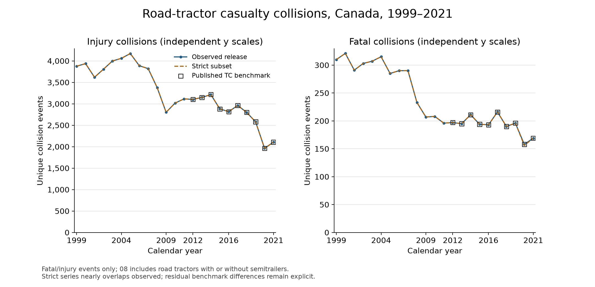
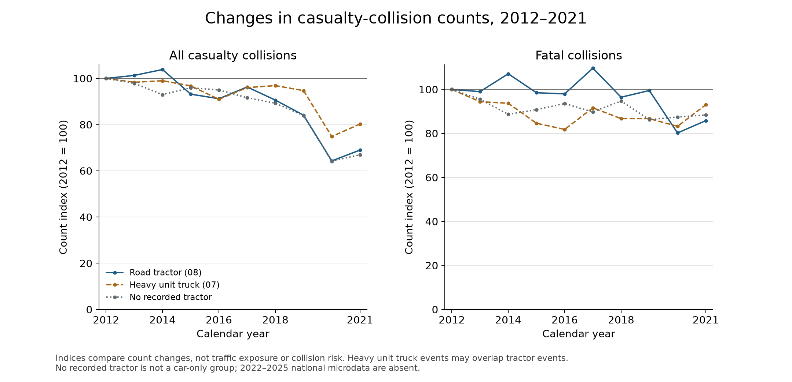
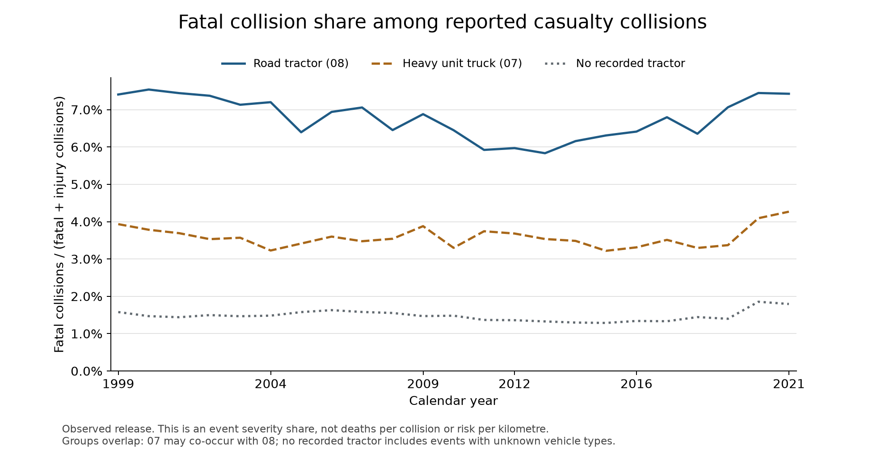

# Descriptive road-tractor casualty-collision trends

## Answer and scope

In this public NCDB release, recorded road-tractor casualty collisions fell from 3,300 in 2012 to 2,276 in 2021 (-31.0%). Fatal collisions fell from 197 to 169 (-14.2%), while injury collisions fell 32.1%. Because fatal events fell more slowly, the fatal share rose from 5.97% to 7.43% (+1.46 percentage points). Fewer reported casualty collisions and a larger fatal share can coexist. The data do not establish more deaths per collision, increased risk per kilometre, or the reasons for the changes.

The recent available segment, 2016–2021, also declined: 3,010 to 2,276 casualty events (-24.4%), with fatal share changing from 6.41% to 7.43%.

The original research target remains **2016–2025 and is unfulfilled**. Event microdata here cover 1999–2021. The complete 2012–2021 window is an explicitly labeled available-data decade that can be checked against Transport Canada's published historical benchmark. Full 1999–2021 annual tables are included for context; choosing that historical window does not extend coverage to 2025.

## Annual tractor results

| Year | Casualty events | Fatal | Injury | Fatal share | Strict exclusions |
| --- | --- | --- | --- | --- | --- |
| 1999 | 4,186 | 310 | 3,876 | 7.41% | 0 |
| 2000 | 4,258 | 321 | 3,937 | 7.54% | 0 |
| 2001 | 3,910 | 291 | 3,619 | 7.44% | 0 |
| 2002 | 4,110 | 303 | 3,807 | 7.37% | 0 |
| 2003 | 4,305 | 307 | 3,998 | 7.13% | 0 |
| 2004 | 4,375 | 315 | 4,060 | 7.20% | 0 |
| 2005 | 4,457 | 285 | 4,172 | 6.39% | 0 |
| 2006 | 4,179 | 290 | 3,889 | 6.94% | 0 |
| 2007 | 4,109 | 290 | 3,819 | 7.06% | 0 |
| 2008 | 3,611 | 233 | 3,378 | 6.45% | 0 |
| 2009 | 3,009 | 207 | 2,802 | 6.88% | 0 |
| 2010 | 3,225 | 208 | 3,017 | 6.45% | 0 |
| 2011 | 3,310 | 196 | 3,114 | 5.92% | 0 |
| 2012 | 3,300 | 197 | 3,103 | 5.97% | 0 |
| 2013 | 3,343 | 195 | 3,148 | 5.83% | 1 |
| 2014 | 3,427 | 211 | 3,216 | 6.16% | 1 |
| 2015 | 3,075 | 194 | 2,881 | 6.31% | 0 |
| 2016 | 3,010 | 193 | 2,817 | 6.41% | 0 |
| 2017 | 3,178 | 216 | 2,962 | 6.80% | 2 |
| 2018 | 2,990 | 190 | 2,800 | 6.35% | 0 |
| 2019 | 2,775 | 196 | 2,579 | 7.06% | 0 |
| 2020 | 2,122 | 158 | 1,964 | 7.45% | 6 |
| 2021 | 2,276 | 169 | 2,107 | 7.43% | 1 |

## Period comparisons and the 2020 disruption

| Period | Casualty change | Fatal change | Injury change | Fatal share change (pp) |
| --- | --- | --- | --- | --- |
| 2012–2021 | -31.03% | -14.21% | -32.10% | +1.46 |
| 2012–2019 | -15.91% | -0.51% | -16.89% | +1.09 |
| 2016–2021 | -24.39% | -12.44% | -25.20% | +1.01 |
| 2016–2019 | -7.81% | +1.55% | -8.45% | +0.65 |
| 2019–2020 | -23.53% | -19.39% | -23.85% | +0.38 |
| 2020–2021 | +7.26% | +6.96% | +7.28% | -0.02 |
| 2019–2021 | -17.98% | -13.78% | -18.30% | +0.36 |

The 2012–2019 comparison shows the direction before 2020; the 2019–2020 and 2020–2021 comparisons show the abrupt fall and partial rebound. The 2019–2021 endpoint comparison shows whether the rebound restored the 2019 count. Calendar 2020 is retained and shown explicitly. These descriptions identify timing, not a causal pandemic estimate. A 2021 endpoint remains affected by the post-2019 period, so the 2012–2021 decline should not be described as an undisturbed secular trend.

Observed fatal counts changed from 193 in 2016 to 196 in 2019 (+1.55%). Source selection is documented in docs/source_release_update.md; the previously used CSV and its results are preserved as a baseline. The published comparison remains separate from the selected microdata.

## Comparison populations

| Group | Period | Casualty start → end | Casualty change | Fatal change | Fatal share start → end |
| --- | --- | --- | --- | --- | --- |
| Road tractor (08) | 2012–2021 | 3,300 → 2,276 | -31.03% | -14.21% | 5.97% → 7.43% |
| Road tractor (08) | 2016–2021 | 3,010 → 2,276 | -24.39% | -12.44% | 6.41% → 7.43% |
| Heavy unit truck (07) | 2012–2021 | 3,884 → 3,117 | -19.75% | -6.99% | 3.68% → 4.27% |
| Heavy unit truck (07) | 2016–2021 | 3,533 → 3,117 | -11.77% | +13.68% | 3.31% → 4.27% |
| No recorded tractor | 2012–2021 | 121,382 → 81,314 | -33.01% | -11.63% | 1.36% → 1.79% |
| No recorded tractor | 2016–2021 | 115,311 → 81,314 | -29.48% | -5.57% | 1.34% → 1.79% |
| No recorded tractor, known types only | 2012–2021 | 119,641 → 79,084 | -33.90% | -11.71% | 1.36% → 1.81% |
| No recorded tractor, known types only | 2016–2021 | 113,333 → 79,084 | -30.22% | -5.60% | 1.34% → 1.81% |

Road tractor means at least one recorded vehicle type 08; heavy unit truck means at least one 07. Those two groups overlap and must not be summed. The no-recorded-tractor group is the complement of recorded 08 involvement, including heavy unit trucks and other vehicles. It is not a car-only comparison and does not establish true absence of tractors when type is unknown. `annual_counts.csv` includes unknown-type counts, overlap counts, and fatality-share denominators. Changes can reflect reporting, vehicle classification, traffic exposure or population composition as well as underlying safety.

The fatal-share increase is not unique to tractors: the no-recorded-tractor share rose from 1.36% in 2012 to 1.79% in 2021, and the heavy unit truck share rose from 3.68% to 4.27%. The tractor/no-recorded-tractor share ratio changed from 4.39 to 4.14. These ratios describe severity mix among reported casualty events, not relative driving risk. The known-types-only comparator excludes any event flagged with other/unknown/unavailable vehicle types and is shown in the comparison tables as a sensitivity; it cannot rule out unflagged misclassification.

## Sensitivity and unresolved source differences

Observed counts retain all events; the strict subset requires `is_analysis_candidate=true`. For tractors this removes 11 of 80,540 events over 1999–2021. These exclusions are an alternative filter, not corrections, and can disproportionately remove complex collisions. Both series appear in the annual and endpoint tables. The observed/strict annual differences, fatal-share changes, and the no-tractor unknown-type share are exported explicitly.

The tiny 2020–2021 tractor fatal-share movement is sensitive to those exclusions: observed share changes from 7.4458% to 7.4253% (−0.0205 percentage points), but strict share changes from 7.3724% to 7.4286% (+0.0562 points). No direction is claimed for that small one-year severity-share movement.

[Transport Canada's published Table 1](https://tc.canada.ca/en/road-transportation/statistics-data/commercial-vehicle-collisions/2021/commercial-vehicle-collisions-canada-2012-2021) remains a separate comparison series. In 2019 selected microdata contain 196 fatal and 2,579 injury tractor events; the publication reports 196 and 2,581. The source-version update substantially reduced the earlier discrepancy; residual differences remain unresolved. No synthetic records or count adjustments force agreement.

| Year | Observed total | Published total | Observed fatal share | Published fatal share | Difference (events) |
| --- | --- | --- | --- | --- | --- |
| 2012 | 3300 | 3300 | 5.97% | 5.97% | 0 |
| 2013 | 3343 | 3345 | 5.83% | 5.83% | -2 |
| 2014 | 3427 | 3427 | 6.16% | 6.16% | 0 |
| 2015 | 3075 | 3075 | 6.31% | 6.31% | 0 |
| 2016 | 3010 | 3010 | 6.41% | 6.41% | 0 |
| 2017 | 3178 | 3178 | 6.80% | 6.80% | 0 |
| 2018 | 2990 | 2990 | 6.35% | 6.35% | 0 |
| 2019 | 2775 | 2777 | 7.06% | 7.06% | -2 |
| 2020 | 2122 | 2122 | 7.45% | 7.45% | 0 |
| 2021 | 2276 | 2276 | 7.43% | 7.43% | 0 |

`benchmark_period_changes.csv` repeats every endpoint comparison for the separately published series. Results with a 2019 endpoint depend on the source version. The principal 2012–2021 and 2016–2021 endpoint comparisons are unaffected by excluding the interior year 2019; source-specific annual differences are shown. No fitted trend is needed to answer the descriptive question, so there is no model in which 2019 is silently retained or omitted.

The following pooled comparisons show sensitivity to omitting 2019, the year with a substantial former source-version discrepancy and a residual benchmark difference. Annual averages divide event totals by included years. Fatal shares use summed fatal counts divided by summed fatal plus injury counts, not an unweighted mean of annual percentages. These block summaries are descriptive and are not adjusted for differing exposures or year composition.

| Block | Subset | Years | Events | Mean annual events | Fatal share |
| --- | --- | --- | --- | --- | --- |
| 2012–2015 | observed | 2012;2013;2014;2015 | 13,145 | 3286.2 | 6.06% |
| 2016–2021 | observed | 2016;2017;2018;2019;2020;2021 | 16,351 | 2725.2 | 6.86% |
| 2016–2021 excluding 2019 | observed | 2016;2017;2018;2020;2021 | 13,576 | 2715.2 | 6.82% |
| 2012–2019 | observed | 2012;2013;2014;2015;2016;2017;2018;2019 | 25,098 | 3137.2 | 6.34% |
| 2012–2019 excluding 2019 | observed | 2012;2013;2014;2015;2016;2017;2018 | 22,323 | 3189.0 | 6.25% |
| 2021 | observed | 2021 | 2,276 | 2276.0 | 7.43% |
| 2012–2015 | strict | 2012;2013;2014;2015 | 13,143 | 3285.8 | 6.06% |
| 2016–2021 | strict | 2016;2017;2018;2019;2020;2021 | 16,342 | 2723.7 | 6.85% |
| 2016–2021 excluding 2019 | strict | 2016;2017;2018;2020;2021 | 13,567 | 2713.4 | 6.81% |
| 2012–2019 | strict | 2012;2013;2014;2015;2016;2017;2018;2019 | 25,094 | 3136.8 | 6.34% |
| 2012–2019 excluding 2019 | strict | 2012;2013;2014;2015;2016;2017;2018 | 22,319 | 3188.4 | 6.25% |
| 2021 | strict | 2021 | 2,275 | 2275.0 | 7.43% |

## Methods and reproducibility

The input is `data/derived/ncdb/collisions.parquet`, one event per `(C_YEAR,C_CASE)`. Severity 1 denotes fatal, 2 injury; casualty count is their sum. Unknown severity would be exported in diagnostics and would stop this analysis rather than entering a severity denominator. Events with multiple tractors count once. No person-record sums or vehicle-involvement totals are used. Input coverage and key uniqueness are asserted. Annual tractor counts and strict counts are separately recomputed and reconciled against the dataset build's `annual_counts.csv` before reporting.

Endpoint percent change is `100 × (end/start − 1)`. Fatal share is `100 × fatal/(fatal+injury)`; share differences are percentage points. There are no fitted trend lines, p-values, confidence intervals or claims of statistical significance. These are complete counts of observed events in this release, rather than a random sample; the material uncertainty is completeness, classification, revisions, exposure and benchmark disagreement. Lack of a sampling interval does not establish complete national ascertainment.

Run `uv sync --extra analysis`, then `PYTHONPATH=src MPLCONFIGDIR=/tmp/collisions-matplotlib .venv/bin/python -m truck_collisions.analyze_trends` from the repository root. The default output is `reports/trends/`. `summary.json` records input hashes, exact principal results, dataset coverage, software versions and checks. CSVs retain unrounded computational values; report and chart display values are rounded. Figures are reproducible standalone PNG and SVG exports, with exported plotted series in `annual_counts.csv` and `benchmark_comparison.csv`.

Source provenance: selected 1999–2013 years from the inherited 1999–2017 file and official annual 2014–2021 releases are mapped in `data/sources.json`; input record hashes are retained in `data/derived/ncdb/source_manifest.json`. See `docs/dataset_contract.md`, `docs/dataset_validation.md`, `docs/ncdb_2019_investigation.md`, and the [official NCDB catalogue](https://open.canada.ca/data/en/dataset/1eb9eba7-71d1-4b30-9fb1-30cbdab7e63a). Historical years before 2012 lack an external tractor-event benchmark in this project. The report is a description of this public release, not a fully reconciled current national series.

## What this establishes and what comes next

The available release supports lower road-tractor casualty-collision counts over 2012–2021 and a higher fatal collision share at the endpoint. It supports neither a 2016–2025 conclusion nor an explanation of why the shares changed. The pre-2020 comparison and benchmark sensitivity prevent the 2021 endpoint from carrying that interpretation alone.

Person identities and casualty scenarios are now validated separately in reports/casualties/findings.md. Before exposure rates, reconcile a compatible tractor distance denominator. Configuration and environmental comparisons remain a subsequent phase. Policy effects, freight activity, vehicle age, pre-impact actions and provincial differences need additional data and suitable comparisons. Public-data availability for 2022–2025 and residual benchmark differences remain explicit; neither aggregate context nor source-version repair supplies missing national event records.
